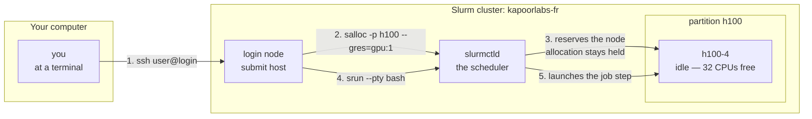

# Slurm commands for monitoring an HPC

The command reference for the coursework in
[`tutorials/hpc_tutorials/`](tutorials/hpc_tutorials/): the notebook
[`hpc_tutorials.ipynb`](tutorials/hpc_tutorials/hpc_tutorials.ipynb) runs
each monitoring script against your cluster and shows what it found, and
[`hpc_dashboard.py`](tutorials/hpc_tutorials/hpc_dashboard.py) is the live
dashboard it all feeds (deployed in notebook §10 and §12 below).

No cluster at hand? The tutorial folder bundles `fake_slurm/` — the
fictional **kapoorlabs-fr** organization (France): GPU nodes named after
their GPUs (`h100-*`, `h200-*`, `b200-*`) plus `cpu-*` nodes — so every
command below can be tried locally. All sample outputs in this file come
from that cluster. To use it, put the fake directory first on your `PATH`
and point `SLURM_CONF` at its `slurm.conf`:

```bash
cd tutorials/hpc_tutorials
export PATH="$PWD/fake_slurm:$PATH"
export SLURM_CONF="$PWD/fake_slurm/slurm.conf"
```

Now `squeue`, `sinfo`, `scontrol`, `sstat`, `sacct` and `sacctmgr` answer
from kapoorlabs-fr on your own machine (open a new shell to undo it).
For the coursework itself, run the notebook:

```bash
cd tutorials/hpc_tutorials
jupyter lab hpc_tutorials.ipynb
```

Every command runs on a **login node**: none need root and none SSH into
compute nodes, the controller already knows everything.

| Script | Commands it runs |
|---|---|
| `hpc_info.py` | `sinfo`, `sacctmgr` |
| `show_free_nodes.py` | `sinfo` |
| `scontroller_nodes.py` | `scontrol show node` |
| `slurm_job_checker.py` | `sacct`, `scontrol show job` |
| `hpc_dashboard.py` | `sinfo`, `squeue`, `scontrol`, `sstat`, `sacct` |

---

## 0. The path from your laptop to a compute node



Read it as two planes:

- **You sit on the login node.** `ssh` gets you there; `sinfo`, `squeue`,
  `scontrol`, `sacct` and `sacctmgr` ask the controller and never touch a
  compute node.
- **`salloc` asks the controller for resources.** The allocation is held
  for you as a job (with a `SLURM_JOB_ID`), and `srun --pty bash` launches
  the step that puts a shell on the allocated node. Without `salloc`, a
  single `srun --pty bash` does steps 2–5 in one command.

> **On the fake cluster** the box is local: `fake_slurm/` replaces every
> command in the diagram, so the same path runs with no SSH and no cluster.

### Where the notebook sections live in this file

| Notebook | Here |
|---|---|
| Setup | intro, above |
| 1 · `sinfo` | §2 |
| 2 · free capacity, `srun` / `salloc` | §2 (free-node rules) and §9 (`srun` / `salloc`) |
| 3 · `scontrol show node` | §3 |
| 4 · `squeue` | §4 |
| 5 · `scontrol show job` | §5 |
| 6 · `sstat` | §6 |
| 7 · `sacct` + job checker | §7 |
| 8 · `sacctmgr` | §8 |
| 9 · cheat sheet | §10 |
| 10 · dashboard | §12 |

---

## 1. How Slurm is organized

| Daemon | Role | Your window into it |
|---|---|---|
| `slurmctld` | the scheduler: every job, node, partition | `squeue`, `sinfo`, `scontrol` |
| `slurmd` (per node) | agent on each compute node; reports real free memory | `%e` of sinfo, `sstat` |
| `slurmdbd` | accounting database | `sacct`, `sacctmgr` |

Vocabulary: **partition** = queue over a set of nodes; **TRES** =
trackable resource (`cpu`, `mem`, `gres/gpu`); **job** = a reservation of
TRES.

`/etc/slurm/slurm.conf` holds the cluster's contract — the resource keys
`scontroller_nodes.py` reads:

| Key | Controls |
|---|---|
| `ClusterName` | identity |
| `SelectType`, `SelectTypeParameters` | how consumable resources are accounted (CR_Core_Memory…) |
| `GresTypes` | which GRES (gpu,mps,…) exist cluster-wide |
| `MaxJobCount`, `MaxArraySize` | scheduler limits |
| `DefMemPerCPU`, `MaxMemPerCPU`, `DefMemPerNode`, `MaxMemPerNode` | memory defaults and ceilings |
| `TaskPlugin` | process isolation (cgroup = enforced limits) |
| `AccountingStorageType`, `AccountingStorageTRES` | whether `sstat`/`sacct` collect memory at all |

If `AccountingStorageTRES` lacks `mem`, every measured-memory feature
(`sstat` MaxRSS) returns nothing — a cluster configuration, not a bug.

## 2. sinfo — node and partition inventory

Used by `hpc_info.py`, `show_free_nodes.py`, `hpc_dashboard.py`.

The dashboard's node table (one line per node):

```bash
sinfo -h -N -o "%N|%P|%C|%m|%e|%G|%l|%T"
```

```
h100-1|h100*|16/16/0/32|2048000|800000|gpu:h100.80gb:8(S:0-1)|7-00:00:00|mixed
h100-4|h100*|0/32/0/32|2048000|2000000|gpu:h100.80gb:8(S:0-1)|7-00:00:00|idle
h200-1|h200*|24/24/0/48|3072000|500000|gpu:h200.141gb:8|7-00:00:00|mixed
b200-1|b200*|32/32/0/64|4096000|100000|gpu:b200.192gb:8|14-00:00:00|mixed
cpu-1|cpu*|64/64/0/128|1024000|300000|(null)|3-00:00:00|mixed
```

| Field | Meaning |
|---|---|
| `%N` | node name |
| `%P` | partition (`*` = the default partition; strip before comparing) |
| `%C` | CPUs as `allocated/idle/other/total` |
| `%m` | configured memory, **MB** |
| `%e` | **free** memory right now, **MB** — reported by the node itself |
| `%G` | GPUs (GRES) |
| `%l` | partition time limit |
| `%T` | state: `idle` `allocated` `mixed` `down` `drained` … |

Variants used by the scripts:

```bash
sinfo -h -N -o "%N|%P|%c|%m|%G|%l|%T"    # inventory without %e (hpc_info.py)
sinfo -N -o '%n %C %G %m %T' --noheader # quick scan: name, CPUs, GPUs, MB, state
                                         # (show_free_nodes.py)
sinfo -h                                # "is the controller up?" probe
```

Reading rules:
- A node in several partitions prints **once per partition** — merge rows.
- The `*` in `%P` marks the default partition. The **state** in `%T` has its
  own suffix flags: `*` not responding, `~` powered down, `#` powering up,
  `!` powering down, `%` rebooting, `@` reboot pending, `^` reboot issued,
  `$` powering down. Strip the flags before classifying.
- Classify the base state: `idle` = nothing running; `mixed` = some CPUs
  free; `allocated` = no free CPUs; `down` / `drained` / `draining` = out of
  service (read `Reason=`). Only `idle` / `mixed` nodes with free resources
  can take a new job.
- `real (%m) − free (%e)` is *used*, and is **not** all jobs — the kernel
  grabs spare RAM for page cache and reclaims it on demand.
- GRES strings pack type, memory, count and a sharing suffix
  (`gpu:h100.80gb:8(S:0-1)`) — parse with a regex that stops before the
  suffix, and count GPUs over **unique** nodes so nodes in two partitions
  are not double-counted.

`show_free_nodes.py` applies exactly these rules: keep nodes with idle
CPUs, drop `drained` / `down` / `failed` nodes, sort fully `idle` nodes
first and then by idle CPU count, and print a ready-to-paste `srun` for the
best GPU node and the best CPU-only node.

## 3. scontrol show node — what the scheduler promised

Used by `scontroller_nodes.py`, `hpc_dashboard.py`.

```bash
scontrol show node h100-1     # one node, human-readable block
scontrol show node -o         # one line per node — parse-friendly
scontrol show node b200-2     # not serving — read Reason=
```

```
NodeName=h100-1 ... CPUAlloc=16 CPUTot=32 RealMemory=2048000 State=mixed
  Partitions=h100 CfgTRES=cpu/32,mem/2048000M,billing/32
  AllocTRES=cpu=16,mem=512G,gres/gpu=8 Gres=gpu:h100.80gb:8(S:0-1) ...
```

| Field | Meaning |
|---|---|
| `RealMemory` | RAM installed (MB) |
| `CfgTRES` | resources configured on the node |
| `AllocTRES` | the **sum of every running job's request** — the promise |
| `State` | with the reason in `Reason=` |
| `Gres` | GPU inventory of the node |
| `ActiveFeatures`, `AvailableFeatures`, `Partitions` | what jobs may request |

Node classification used by `scontroller_nodes.py`:

```
DRAIN/DOWN in state  → broken       (read Reason)
ALLOC/MIXED in state → busy
otherwise            → free
```

The script's summary counts any node with a running job as busy. For
*placement*, `mixed` is only partly busy: it still has free CPUs — and, for
the dashboard's traffic lights, needs a free GPU too.

## 4. squeue — running and waiting jobs

Used by `hpc_dashboard.py`.

```bash
squeue -h -t RUNNING -o "%i|%u|%j|%N|%P|%C|%m|%b|%M|%L"
```

```
10020_74|varun|pretrain|h100-[1-2]|h100|16|100G|gpu:2|10:00|20:00
2001|sofie|finetune|h100-2|h100|8|51200|gpu:1|1:00:00|3:00:00
```

| Field | Meaning |
|---|---|
| `%i` | job id — array jobs print `arrayid_task`, e.g. `10020_74` |
| `%u` / `%j` | user / job name |
| `%N` | node list — **compressed**: `h100-[1-2]`, `cpu-[1-3,5]` |
| `%P` | partition |
| `%C` | CPUs |
| `%m` | requested memory — *usually* plain MB, but see §5 |
| `%b` | GRES (GPUs) |
| `%M` / `%L` | runtime / time left |

```bash
squeue -h -t PENDING -o "%P"    # one partition name per queued job
squeue -h -t PENDING -o "%P" | sort | uniq -c | sort -rn   # queue depth per partition
```

A pending job's reason (`squeue -o "%i %R"`) answers "why is it waiting":
`Resources`, `Priority`, `QOSMaxJobsPerUserLimit`, `ReqNodeNotAvail`.

## 5. scontrol show job — the request, exactly as stored

Used by `slurm_job_checker.py`, `hpc_dashboard.py`.

```bash
scontrol show job -o            # every job, one line each
scontrol show job 10020_74      # one job in full
```

```
JobId=10020_74 UserId=varun(42) JobName=pretrain RunTime=10:00 TimeLimit=20:00
  MinMemory=100G TresPerNode=gres:gpu:2 NodeList=h100-[1-2] NumCPUs=16 State=RUNNING
```

| Output | Meaning |
|---|---|
| `MinMemory=100G` | `--mem 100G` — 100 GB **per node** |
| `MinMemory=1024c` | old per-CPU form: `--mem-per-cpu 1G` |
| `MinMemory=0 MinCPUsMemory=5G` | newer per-CPU form |
| `MinMemory=0` | the job requested **no** memory |
| `TresPerNode=gres:gpu:2` | GPUs requested |
| `RunTime=` / `StartTime=` / `EndTime=` | elapsed / reservation window |
| `Command=`, `WorkDir=` | what was submitted, from where |

**The unit trap:** `squeue %m` looks like a plain MB number and a naive
`int(mem)/1024` "works" — until a job submits `#SBATCH --mem 100G` and the
parser silently shows **0 GB for every job**. Rules: prefer
`scontrol show job -o` over `%m`; multiply a per-CPU request by the job's
CPU count; never render "no request" as `0 GB` — show the words.

## 6. sstat — live memory per running job

Used by `hpc_dashboard.py`.

```bash
sstat -j 10020_74,2001 --format=JobID,MaxRSS -P --noheadings
```

```
10020_74.batch|67108864K
2001.batch|5242880K
```

- Reports actual RSS **from the node itself** via the controller — no SSH.
- One line **per job step** (`.batch`, `.0`, …): take the max per job id
  after stripping the suffix.
- Values arrive as `2097152K`, `1.5G`, or a bare **KB** number — note the
  unit convention difference from the scheduler fields (bare = MB there,
  bare = KB here).
- Empty output = the cluster's accounting does not collect it; show
  "unknown", never zero.

## 7. sacct — history and measured usage

Used by `slurm_job_checker.py`, `hpc_dashboard.py`.

```bash
# a user's recent jobs (slurm_job_checker.py)
sacct -u varun --starttime now-24hours --format=JobID --noheader -X
sacct -u varun --starttime now-24hours \
    --format=JobID,JobName,State,ExitCode,Start,End,NodeList -X -P

# measured memory of a job (hpc_dashboard.py fallback)
sacct -j 10020_74 -X -o JobID,MaxRSS --parsable2 --noheader
```

Options that matter: `-X` = allocation records only (skip step lines);
`-P`/`--parsable2` = `|`-separated, no headers; `-a` = all users;
`--starttime`/`--endtime` = the window; `now-24hours` works as a relative
start.

`State` values worth knowing: `RUNNING`, `COMPLETED`, `FAILED`, `TIMEOUT`,
`OUT_OF_MEMORY` — OOM kills land in `OUT_OF_MEMORY`, the first place to
look when a user says "my job died". That is exactly what
`slurm_job_checker.py` flags.

## 8. sacctmgr — who may run what

Used by `hpc_info.py`.

```bash
sacctmgr -nP show associations user=varun format=Account,Partition,QOS
```

Access = account + partition + QOS. A pending job with a `QOS*Limit*`
reason is limited here, not by resources.

## 9. srun, salloc and scancel — acting through the scheduler

Recommended by `show_free_nodes.py` for landing on a free node:

```bash
srun --nodelist=h200-3 --gres=gpu:1 --pty bash    # interactive shell with a GPU
srun --nodelist=cpu-2 --pty bash                   # interactive shell, CPU node
scancel 10020                                      # kill one job
```

`srun -w <node> --pty bash` is the safe admin way to land on a node — it
goes through the scheduler, unlike SSH, which many clusters forbid.

`srun` creates an allocation and runs one step in it; the allocation ends
with that step. `salloc` creates the allocation and keeps it alive across
steps. Its default shell normally starts on the submit host, so get onto a
compute node with `srun --pty bash`; every `srun` inside shares the
allocation, and `exit` or `scancel` releases it:

```bash
salloc --partition=h100 --gres=gpu:1 --cpus-per-task=8 --mem=64G
srun --pty bash             # compute-node shell, allocation's CPUs/memory
srun python train.py        # runs in the held allocation
srun python evaluate.py
exit                        # releases the allocation
```

So `salloc` then `srun --pty bash` is a valid way to get an interactive
shell with all the allocated CPUs and memory; the difference from a plain
`srun --pty bash` is lifecycle, not capability. Steps inherit
`SLURM_CPUS_PER_TASK` and are capped by the job's memory reservation, so
`salloc -c 8 --mem=64G` plus `srun --pty bash` gives 8 CPUs and 64 GB;
`--exclusive` gives a step the whole allocated share.

An idle `salloc` still occupies the nodes — it appears as a job in
`squeue`, and other users queue behind it. `sbatch job.sh` is the third
form: hand the scheduler a script and return; the allocation ends when the
script does.

## 10. Cheat sheet

| I want to know… | Command |
|---|---|
| What hardware exists | `sinfo -N -o "%N %P %C %m %G %T"` |
| Which nodes are free | `sinfo` + the free-node script (idle CPUs, not drained) |
| Where to run right now | `python show_free_nodes.py` → `srun --nodelist=… --pty bash` |
| Hold an allocation for several steps | `salloc --partition=… --gres=gpu:1` → `srun …` → `exit` |
| What a node has reserved | `scontrol show node <node>` (`AllocTRES`) |
| What is running | `squeue -o "%i %u %j %N %P %C %M %L"` |
| Why my job is pending | `squeue -o "%i %R"` |
| What a job requested | `scontrol show job <jobid>` (`MinMemory`, `TresPerNode`) |
| How much memory it uses | `sstat -j <jobid> --format=JobID,MaxRSS` |
| What happened to a job | `sacct -j <jobid> -X -o JobID,State,ExitCode` |
| What I may run | `sacctmgr -nP show associations user=$USER format=Account,Partition,QOS` |
| Kill a job | `scancel <jobid>` |

**The one rule that prevents most wrong answers:** a free CPU count is not
permission to run. Check the node state (`drained`?), the user's association
(`sacctmgr`), and the job record (`scontrol show job`) before concluding
anything.

## 11. Reading memory like a sysadmin

Three different numbers, all correct:

1. **real** (`sinfo %m`, `RealMemory`) — RAM installed.
2. **allocated** (`AllocTRES`, `MinMemory`) — what jobs asked for and the
   scheduler reserved. May exceed what processes actually touch.
3. **free** (`sinfo %e`) — what the node reports as available.

The gap between `real − free` and job usage is mostly **page cache**,
reclaimed automatically when jobs need it. High used + low free on an
idle node is *normal*. The alarm case is jobs that **measured** (sstat /
sacct) far more than they **requested** — OOM risk for neighbours on
nodes without cgroup enforcement. The dashboard's node tab and its
"memory eaters" table are built around exactly this distinction.

## 12. The live dashboard — hpc_dashboard.py

Everything above, live, in a browser: three tabs (partitions, node detail,
top jobs) built from the same commands, with nothing hardcoded to one
cluster.

The partition tiles are lit from **node-level availability** — in service,
an idle CPU, and a free GPU on GPU nodes — not from queue depth. A long
queue on free hardware stays green; an empty queue on full hardware goes
red.

Deploy it on the head node:

```bash
streamlit run hpc_dashboard.py        # serves on port 8501
```

Reach it from your laptop with an SSH tunnel:

```bash
ssh -N -L 8501:localhost:8501 <user>@<headnode>
```

Then open **http://localhost:8501**.

> **Tunnel caveat:** auto-refresh does not travel through the tunnel
> reliably. The page fetches new data when you interact with it or press
> *Refresh now*, not on a timer.

